## Operaciones básicas con opencv en python
### Alumno: Arath Valenzuela (NC:0148) 
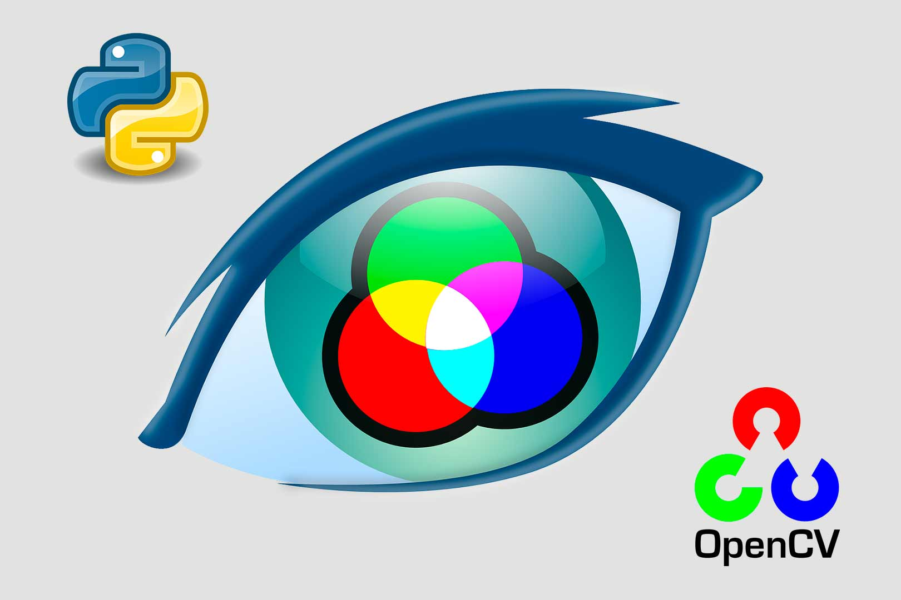
# 1. LECTURA DE LA IMAGEN DESDE LA CARPETA
#### Cuando no puede cargar la imagen 
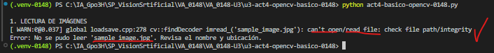
#### Cuando puede leer la imagen 
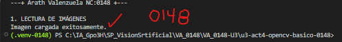
# 2. PROPIEDADES DE LA IMAGEN
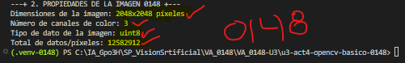
# 3. VISUALIZACIÓN DE LA IMAGEN ORIGINAL

## Mostrando imagen original 
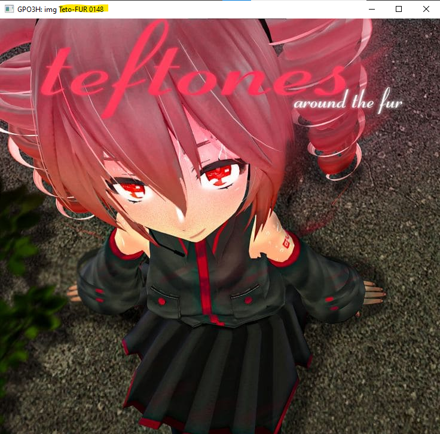

## En la terminal 
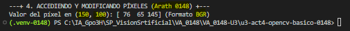

## # 4. ACCESO Y MODIFICACIÓN DE PÍXELES INDIVIDUALES 
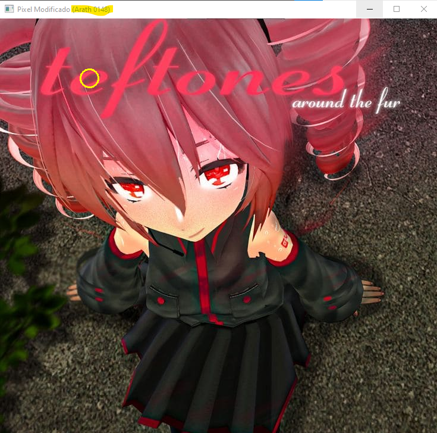

## 5. REGIÓN DE INTERÉS (ROI - REGION OF INTEREST)
### ROI marcada 
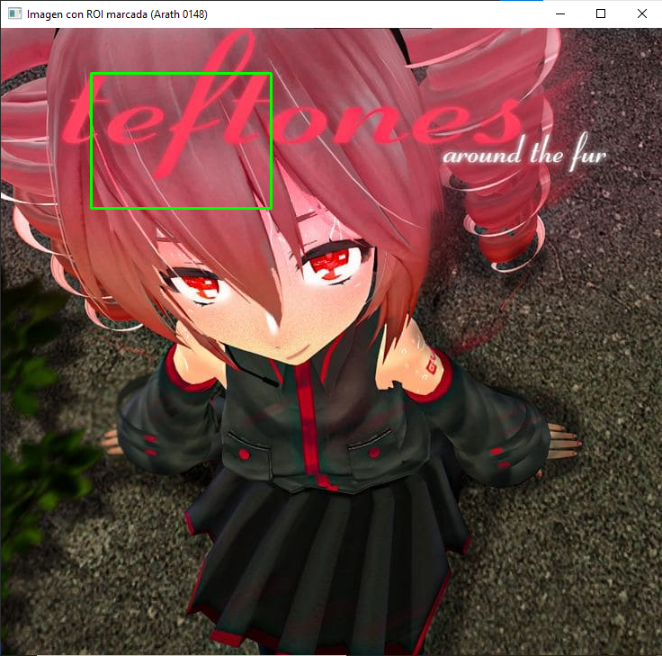
### ROI extraida 
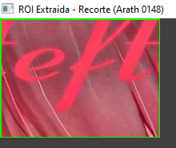

## 6. SEPARACIÓN Y FUSIÓN DE CANALES DE COLOR (BGR)
### Canal Rojo (Grises)
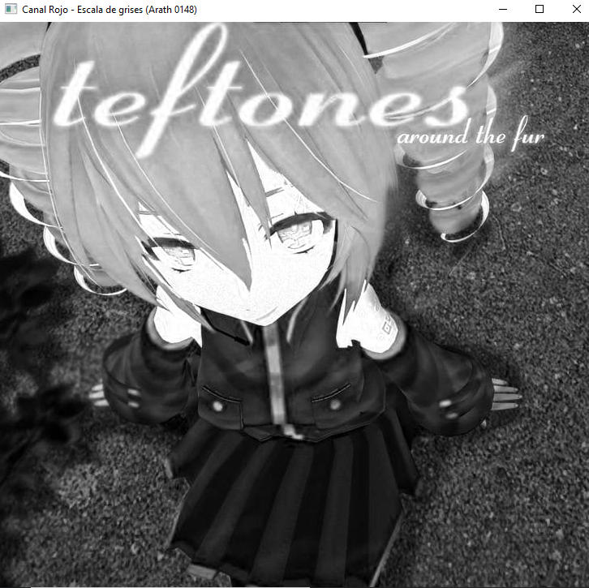
### Canal Verde (Grises)
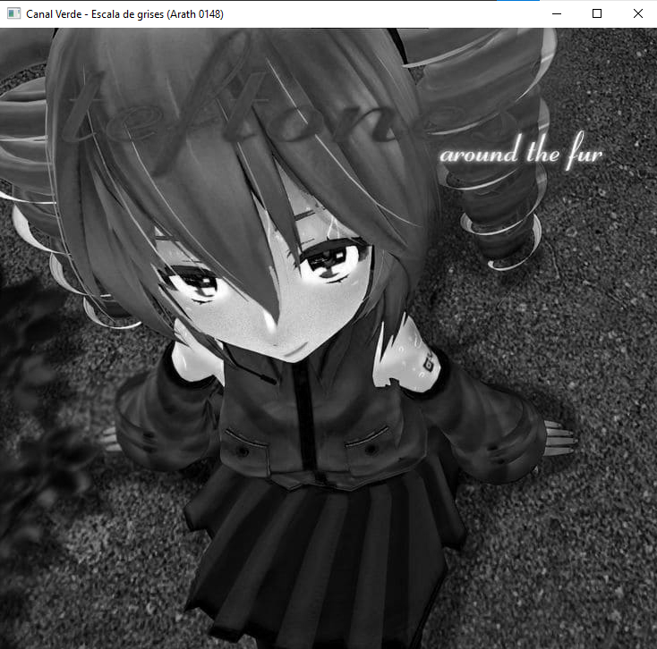
### Canal Azul
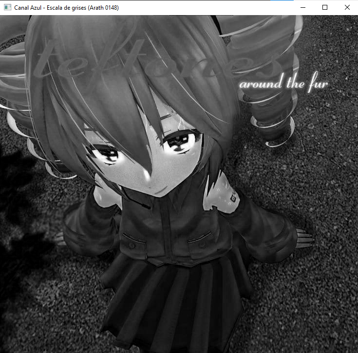

### Canal Rojo (Coloreado)
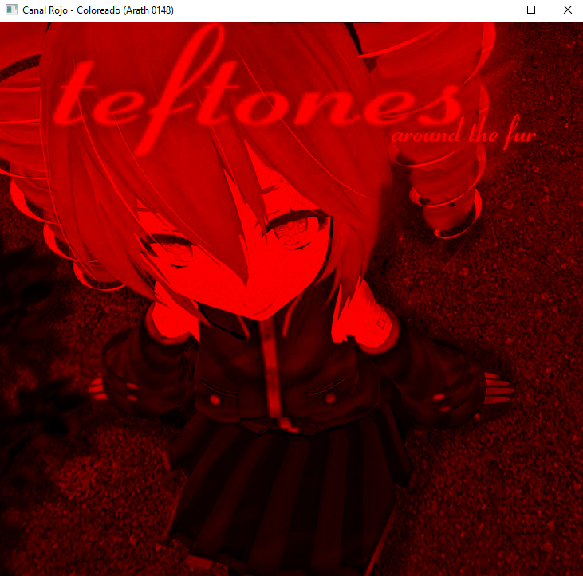
### Canal Verde (Coloreado)
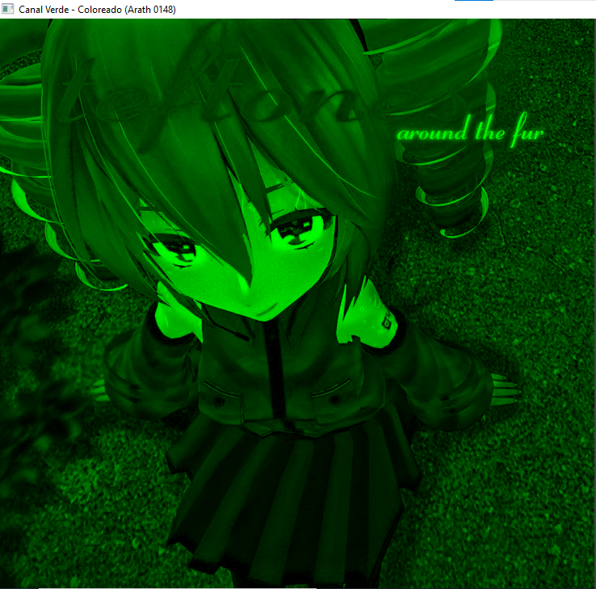
### Canal Azul (Coloreado)
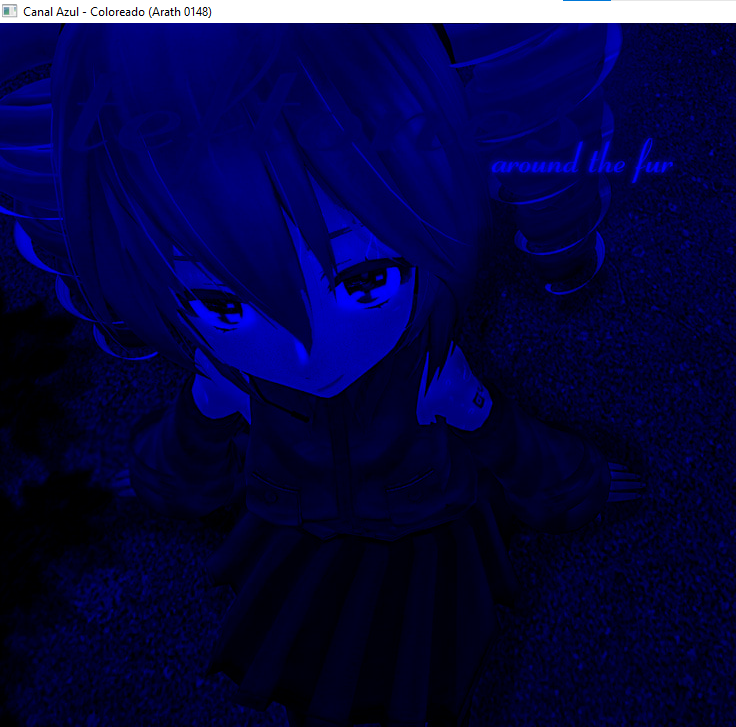

## 7. REDIMENSIONAMIENTO DE IMÁGENES (RESIZING)
### IMG redimensionada a 400*300
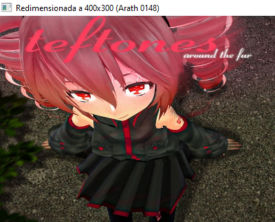
### IMG redimensionada a 0.5x
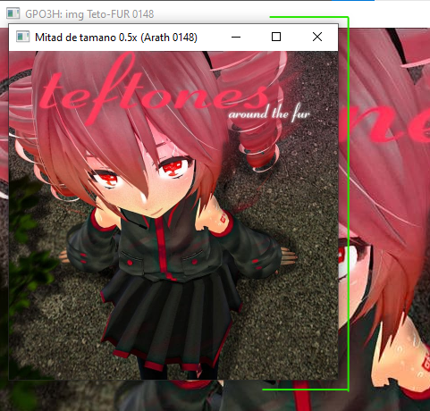
### IMG redimensionada a 1.5x
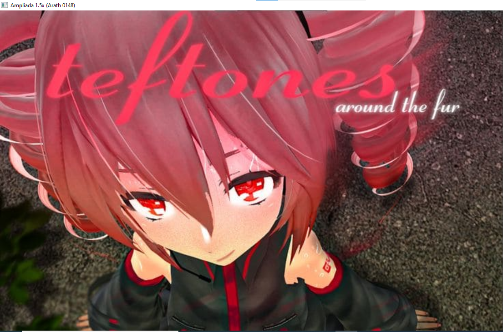

## 8. ROTACIÓN DE IMÁGENES
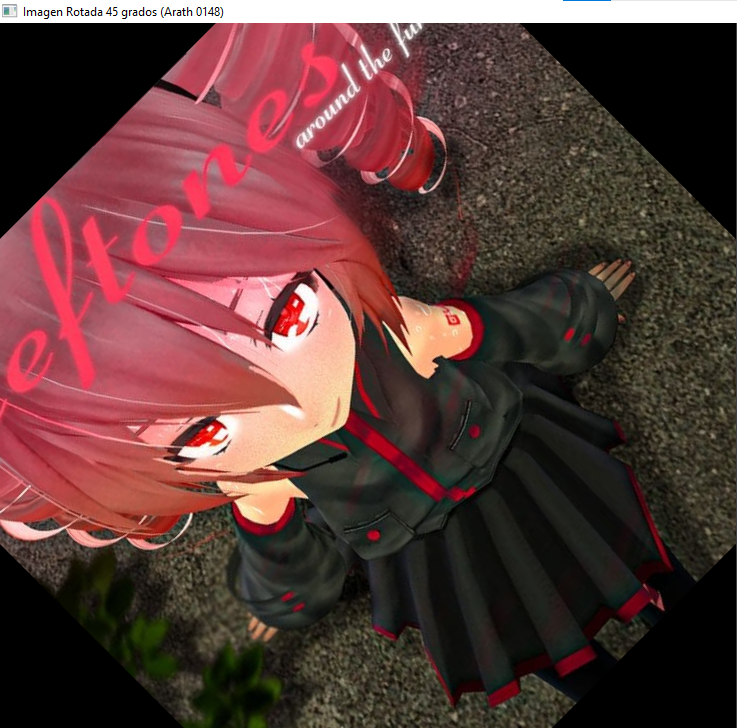

## 9. VOLTEO / ESPEJO DE IMÁGENES (FLIPPING)
### Volteo en espejo
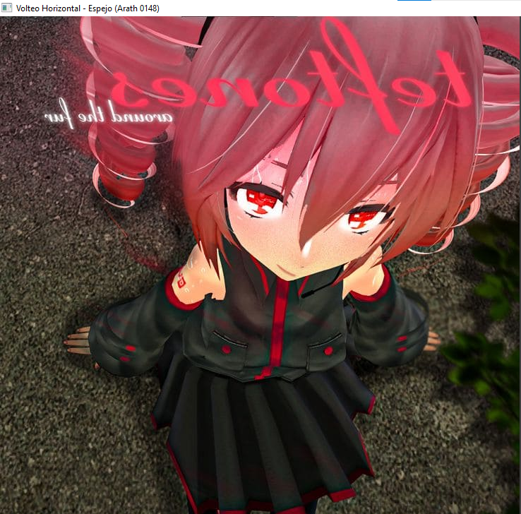
### Volteo de cabeza
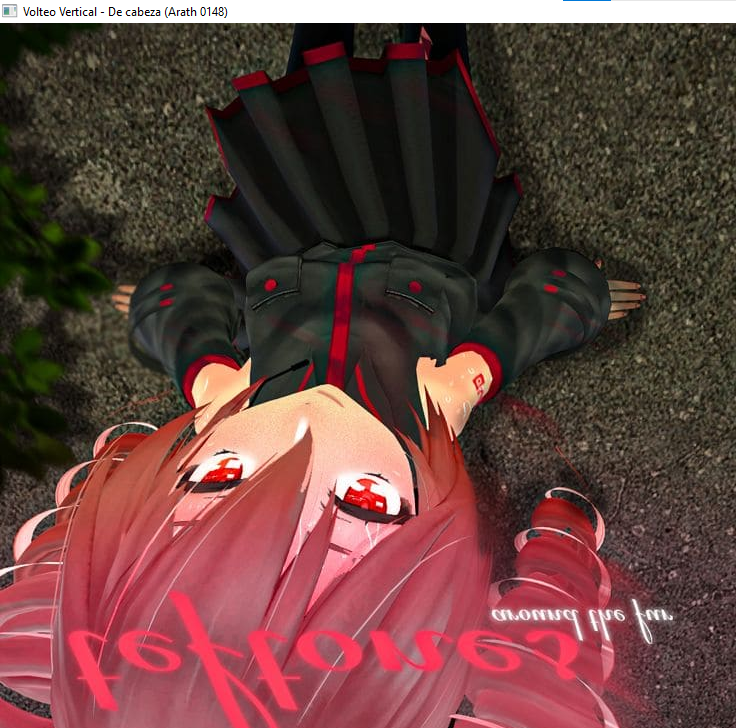
### Ambos ejes
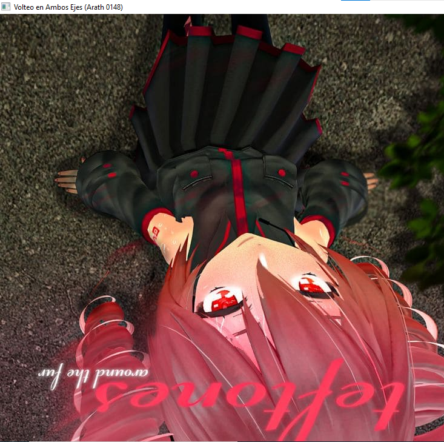

## 10. GUARDADO DE RESULTADOS Y LIMPIEZA
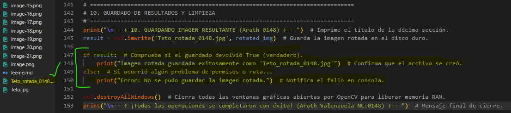
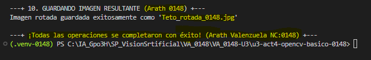